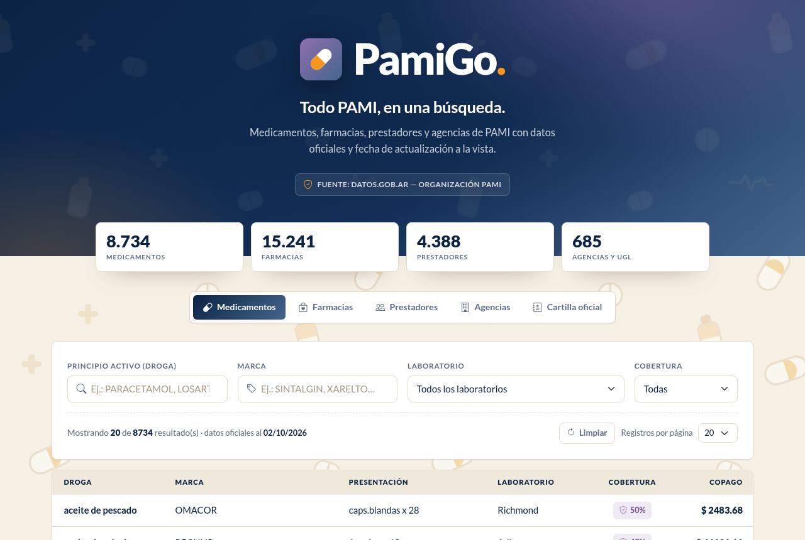

# PamiGo

Aplicación web para consultar cobertura y copago de medicamentos, farmacias habilitadas y resumen de
prestadores del Instituto Nacional de Servicios Sociales para Jubilados y Pensionados (PAMI), construida
sobre los conjuntos de datos abiertos publicados por el organismo.

Es un sitio estático: no requiere backend, servidor de aplicaciones ni base de datos. La búsqueda, el
filtrado y la paginación se resuelven íntegramente en el navegador.

Versión actual: **1.2.0**



> Proyecto independiente, desarrollado con fines de portfolio. No tiene vínculo oficial con PAMI.
> La información es referencial y la cobertura final la confirma la farmacia al momento de dispensar.

---

## Funcionalidades

### Medicamentos
- Búsqueda por principio activo (droga) y por marca, con filtros combinables e insensible a mayúsculas
  y tildes (escribir "losartan" encuentra "losartán").
- Filtro por laboratorio: el selector muestra el conteo de productos y sus opciones se recalculan según la
  droga y la marca ingresadas, de modo que solo aparecen los laboratorios que fabrican ese medicamento.
- Filtro por cobertura mediante selector, con los cinco valores del conjunto y su cantidad de registros.
- Resultados paginados con selector de tamaño de página (10, 20, 50 o 100 registros).
- Visualización de cobertura como indicador y del copago en pesos.
- Acción "Limpiar" en la barra de resultados, junto al selector de registros por página.

### Farmacias
- Filtro en cascada por provincia y localidad: al elegir una provincia, el selector de localidades se
  recalcula con las localidades disponibles en ese conjunto.
- Búsqueda de texto libre sobre nombre, dirección y localidad.
- Paginación con el mismo comportamiento que la tabla de medicamentos.

### Prestadores
- Resumen de cantidad de prestadores por UGL (Unidad de Gestión Local) y módulo PAMI.
- Búsqueda por UGL, descripción o módulo.
- Enlace a la cartilla oficial para la búsqueda de médicos, sanatorios y laboratorios habilitados.

### Navegación y URLs
- URLs amigables sin extensión: `/medicamentos`, `/farmacias`, `/prestadores`, `/cartilla`.
- Cada pestaña tiene URL propia, título de documento propio y soporta enlaces directos.
- Integración con el historial del navegador (botón atrás y adelante).
- Redirección 301 desde `/pami.html` y desde cualquier `.html` hacia su versión sin extensión.
- Página 404 personalizada con la identidad de la aplicación.

### Interfaz y accesibilidad
- Diseño responsive verificado en 320, 390, 768 y 1280 px.
- Por debajo de 576 px las tablas pasan a formato tarjeta con etiquetas por campo, sin scroll horizontal.
- Etiquetas asociadas a los campos mediante `for`/`id`, `aria-label` en elementos gráficos y foco visible.
- Contraste de texto ajustado sobre fondos oscuros y claros.

### Distribución
- Sin dependencias en tiempo de ejecución más allá de CDN para estilos e iconografía.
- Datos servidos como JSON estático, con revalidación de assets mediante `?v=` y cabeceras de caché.
- Manifiesto web para instalación en dispositivos móviles, `robots.txt` y `sitemap.xml`.

---

## Stack tecnológico

| Capa | Tecnología | Uso |
|---|---|---|
| Estructura | HTML5 semántico | Documento único con vistas por pestaña |
| Estilos | CSS3 con custom properties | Sistema de diseño propio, tokens de color y tipografía |
| Estilos base | Bootstrap 5.3 | Grilla, utilidades y comportamiento de pestañas |
| Iconografía | Bootstrap Icons 1.11 | Iconos de interfaz |
| Interacción | Alpine.js 3 | Estado reactivo, filtros, paginación |
| Navegación | JavaScript (ES5/ES6) propio | Router de URLs amigables sobre el historial del navegador |
| Tipografía | Lato (Google Fonts) | Pesos 400, 700 y 900 |
| Datos | JSON estático | 25.000 registros precargados y versionados |
| Desarrollo | Node.js | Servidor local `serve.js` con reescritura de rutas |
| Despliegue | Apache, Netlify, Cloudflare Pages o Vercel | Archivos de configuración incluidos |

Sin frameworks de compilación, sin `npm install` obligatorio y sin proceso de build: el código se
entrega tal como se sirve.

---

## Estructura del proyecto

```
.
├── index.html          Documento principal
├── 404.html            Página de error
├── pami.css            Sistema de diseño y estilos
├── pami.js             Estado y lógica de búsqueda (Alpine)
├── router.js           Router de URLs amigables
├── favicon.svg         Monograma para la pestaña del navegador
├── logo.svg            Marca de la aplicación
├── site.webmanifest    Metadatos de instalación
├── robots.txt          Directivas de indexación
├── sitemap.xml         Mapa del sitio
├── data/
│   ├── medicamentos.json   8.734 registros
│   ├── farmacias.json     13.689 registros
│   └── prestadores.json    2.520 registros
├── data/meta.json      Fecha, origen y volumen de cada conjunto
├── scripts/
│   ├── fetch_data.py   Descarga los conjuntos oficiales vigentes
│   ├── build_data.py   Normaliza, carga en SQLite y exporta los JSON
│   └── check.js        Verificación previa al despliegue
├── docs/preview.png    Captura para documentación
├── serve.js            Servidor de desarrollo con URLs amigables
├── .htaccess           Configuración Apache / cPanel
├── _redirects          Configuración Netlify / Cloudflare Pages
├── vercel.json         Configuración Vercel
├── CHANGELOG.md        Historial de versiones
└── DEPLOY.md           Guía de despliegue
```

---

## Datos y fuentes

Los datos se obtienen de los conjuntos publicados por PAMI en el portal de datos abiertos del Estado
nacional y se transforman a JSON para su consumo desde el navegador.

| Conjunto | Registros | Campos principales |
|---|---|---|
| Listado de precios de medicamentos para afiliados | 8.734 | droga, marca, presentación, laboratorio, cobertura, copago |
| Farmacias habilitadas | 13.689 | provincia, UGL, farmacia, dirección, localidad, código postal |
| Resumen de prestadores por UGL y módulo | 2.520 | UGL, descripción, módulo, cantidad de prestadores |

Fuentes:

- Portal de datos abiertos: <https://datos.gob.ar/>
- Organización PAMI en datos.gob.ar: <https://datos.gob.ar/organization/instituto-nacional-de-servicios-sociales-para-jubilados-y-pensionados-pami>
- Listado de precios de medicamentos para afiliados: <https://datos.gob.ar/dataset/medicamentos-para-afiliados>
- Cartilla oficial de prestadores: <https://prestadores.pami.org.ar/>

Los archivos originales se distribuyen en XLSX y CSV. La preparación se automatiza con dos scripts:

```bash
python3 scripts/fetch_data.py     # resuelve las URLs vigentes y descarga los crudos a data/raw/
python3 scripts/build_data.py     # normaliza, carga en SQLite y exporta data/*.json + data/meta.json
```

`fetch_data.py` consulta la API de datos.gob.ar (`package_show`) y elige el recurso más reciente de cada
conjunto, guardando un manifiesto de procedencia. `build_data.py` requiere `openpyxl`, carga los datos en
`data/raw/pami.db`, limpia codificaciones dañadas y serializa los JSON con claves cortas y estables.

Los archivos crudos y la base de trabajo no se versionan; `data/meta.json` deja registrada la fecha de
cada conjunto y el pie de la aplicación la muestra.

| Conjunto | Datos al | Registros |
|---|---|---|
| Medicamentos | 02/10/2026 | 8.734 |
| Farmacias | 07/07/2022 | 13.689 |
| Prestadores | 03/08/2022 | 2.520 |

Los dos últimos están pendientes de actualización: los archivos vigentes cambiaron de esquema y requieren
un remapeo de columnas (ver CHANGELOG).

---

## Puesta en marcha

Requisitos: Node.js 18 o superior.

```bash
node serve.js            # http://127.0.0.1:5176
PORT=8080 node serve.js  # puerto alternativo
```

`serve.js` reproduce en local el comportamiento de producción: resuelve rutas amigables, aplica las
redirecciones 301 de los `.html` y devuelve la página 404 propia. Un servidor de archivos común, como
`python3 -m http.server`, sirve correctamente la portada pero no las rutas amigables.

---

## Despliegue

El proyecto incluye configuración para los entornos más habituales. Los detalles y la lista de
verificación previa a la publicación están en [DEPLOY.md](DEPLOY.md).

| Plataforma | Archivo de configuración |
|---|---|
| Apache / cPanel | `.htaccess` |
| Netlify / Cloudflare Pages | `_redirects` |
| Vercel | `vercel.json` |

Antes de publicar, reemplazar `TU-DOMINIO` en `sitemap.xml` y en la etiqueta `canonical` de `index.html`.

---

## Integración continua

`.github/workflows/ci.yml` se ejecuta en cada push a `main` y en cada pull request, con dos etapas:

1. **Verificación de contenido** (`node scripts/check.js`, sin dependencias): archivos obligatorios, JSON
   válido, esquema y volumen de los tres conjuntos de datos, referencias locales de los documentos,
   metadatos y accesibilidad básica, coincidencia de versión entre `package.json`, el HTML, el footer y
   el `CHANGELOG`, presencia de las rutas amigables en cada configuración de despliegue, archivos crudos o
   con datos personales fuera de control de versiones y presupuesto de peso de los datos con gzip.
2. **Rutas y 404**: levanta `serve.js` y comprueba los códigos de estado de las cuatro vistas, los assets,
   la página 404 y la redirección 301 de la URL anterior.

Se puede ejecutar localmente:

```bash
node scripts/check.js   # o: npm test
```

---

## Decisiones técnicas

**Sin backend.** El volumen de datos (25.000 registros, 5,2 MB en JSON) permite resolver todas las
consultas en el cliente. Esto elimina costos de infraestructura, latencia de red por consulta y
superficie de ataque, y permite alojar el sitio en cualquier CDN o hosting estático.

**Un único documento.** Las cuatro vistas comparten el mismo documento y se alternan por pestañas. El
router mantiene una URL y un título por vista sin recargar ni duplicar marcado.

**CSS propio sobre Bootstrap.** Bootstrap se usa solo para la grilla, las utilidades y el componente de
pestañas. El sistema visual, la tipografía y los componentes de tabla son propios, con tokens en
custom properties.

**Datos versionados como archivos.** Mientras la actualización sea periódica y no en tiempo real, versionar
los JSON permite reproducir cualquier estado del sitio y auditar cambios mediante `git diff`.

---

## Limitaciones conocidas

- La primera carga descarga los tres conjuntos de datos en paralelo (5,2 MB sin comprimir, 537 KB con
  gzip). En conexiones móviles lentas la tabla puede tardar unos segundos en poblarse.
- La búsqueda es por coincidencia de subcadena: insensible a mayúsculas y tildes, pero sin tolerancia a
  errores de tipeo ni a sinónimos del principio activo (el conjunto original usa formas como
  "acetilsalicílico,ác." en lugar de "ácido acetilsalicílico").
- El conjunto de datos original trae nombres de laboratorio con caracteres corruptos ("Bag¿" en lugar de
  "Bagó") y truncados a 15 caracteres ("Laboratorios Be"). Se muestran tal como llegan; la corrección
  corresponde a la etapa de preparación de datos.
- No hay actualización automática de datos: cada nueva publicación del organismo requiere regenerar los JSON.
- El archivo de afiliados del organismo contiene datos personales y no forma parte de este proyecto.

## Hoja de ruta

- Carga diferida por pestaña: descargar cada conjunto solo cuando se abre su vista.
- Persistencia de filtros en la URL para compartir búsquedas.
- Exportación de resultados a CSV.
- Normalización de drogas con sinónimos y tolerancia a errores de tipeo.
- Evaluación de una capa de consulta del lado del servidor si el volumen de datos o los requisitos de
  búsqueda superan lo que conviene resolver en el cliente.

---

## Autor

Jorge Ariel Pardo — Desarrollador web
En colaboración con Glyph-cluster.

Los datos pertenecen a sus fuentes oficiales. El código se publica con fines de portfolio; no se concede
licencia de reutilización sin autorización.
